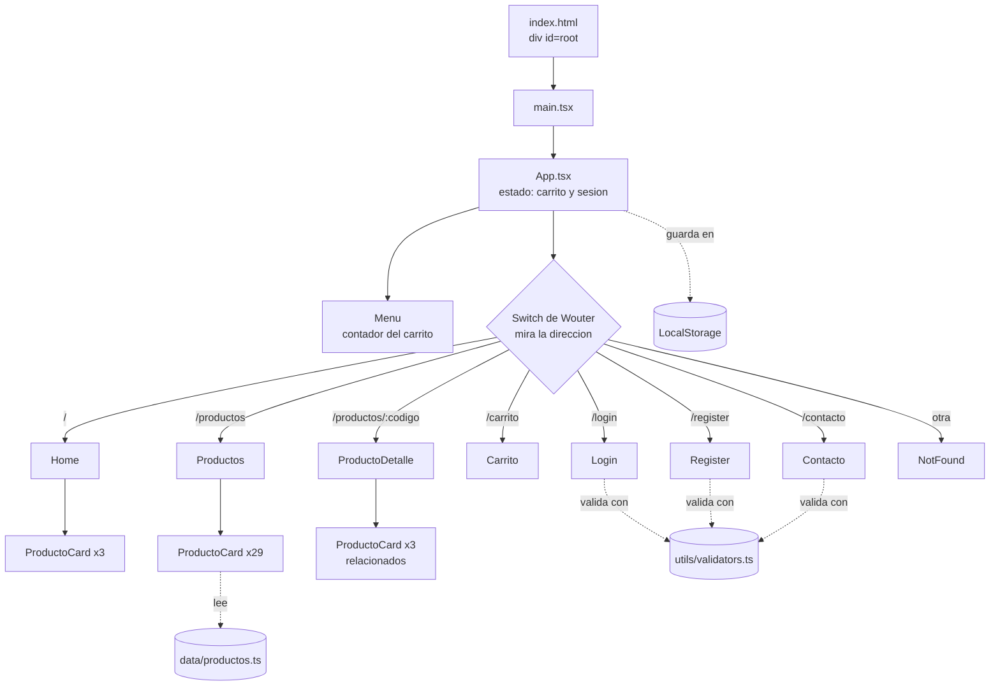

# 🧭 Esquema: cómo se ve la tienda por dentro

## 1) Carpetas (qué hace cada una)

```
Proyecto_Fullstack_II/
├── index.html               ← la ÚNICA página HTML real (tiene un <div id="root">)
├── package.json             ← librerías y comandos (npm run dev...)
├── vite.config.ts           ← configura Vite (React + Tailwind)
├── public/
│   ├── favicon.svg
│   └── imgs/                ← 🖼️ todas las fotos (.webp), incluido fondo.webp
└── src/
    ├── main.tsx             ← conecta React con el <div id="root">
    ├── index.css            ← 🎨 colores, fondo y clases propias (.panel, .boton, .entrada)
    ├── App.tsx              ← 🎬 guarda carrito + sesión y elige qué página mostrar
    ├── data/
    │   ├── productos.ts     ← 📦 los 29 productos y las categorías del filtro
    │   └── regiones.ts      ← regiones y comunas del registro
    ├── utils/               ← 🧰 lógica sin pantallas (con pruebas .test.ts)
    │   ├── carrito.ts       ← agregar, quitar, cambiar cantidad, total
    │   ├── validators.ts    ← reglas de login, registro y contacto
    │   ├── run.ts           ← validar y formatear el RUN
    │   ├── storage.ts       ← lee/guarda en LocalStorage (carrito, sesión, usuarios)
    │   ├── auth.ts          ← iniciar sesión (admin de prueba o cliente)
    │   └── formato.ts       ← precios como $6.990
    ├── components/          ← 🧱 piezas que se repiten
    │   ├── menu/  footer/  page-title/  mensaje/
    │   ├── producto-card/   ← tarjeta de UN producto
    │   ├── cantidad-input/  ← cajita de cantidad (detalle y carrito)
    │   ├── field/           ← campo de formulario (input, select o textarea) con su error
    │   └── photo/           ← imagen que avisa qué archivo falta si no carga
    └── pages/               ← 📄 una carpeta por página
        └── home/ productos/ producto-detalle/ carrito/ login/ register/ contacto/ not-found/
```

## 2) Cómo viaja una visita



## 3) Qué pasa al agregar un producto al carrito

```
[Agregar al carrito]  →  App.handleAgregar()  →  utils/carrito.agregarItem()
        (ProductoCard)        (setCarrito)           (devuelve carrito nuevo)
                                   │
                                   ├─→ Menu: el numerito se actualiza
                                   └─→ useEffect: guarda en LocalStorage ("ssm_carrito")
```

## 4) Cómo se ordena en pantalla

```
Computador                              Celular
┌────────┬───────────────────────┐      ┌──────────────────────┐
│ MENÚ   │  CONTENIDO            │      │ Secret Sweet Maid [☰]│ ← el ☰ abre los links
│ rosado │  (la página activa)   │      ├──────────────────────┤
│ fijo   │  + Footer             │      │  CONTENIDO           │
│ 3/12   │  9/12                 │      │  (1 columna)         │
└────────┴───────────────────────┘      └──────────────────────┘
 Tarjetas: 3 columnas → 2 → 1 según el ancho
```

## 5) Dos ideas clave para entender el código

1. **Componente = una función que devuelve "HTML"** (se llama JSX). `<ProductoCard producto={...} />` es como pegar una tarjeta ya armada; la repito con `.map()` por cada producto.
2. **Estado (`useState`)** = la memoria de un componente. Cuando cambia, React vuelve a dibujar solo lo necesario. Ejemplos: `carrito` y `sesion` en `App.tsx`, `categoria` en el filtro de Productos.

## 6) Qué corregí respecto a la versión HTML

- El fondo nunca se veía: la ruta era `img/fondo.png` y la carpeta se llama `imgs`.
- `DOMINIOS_PERMITIDOS` nunca estaba definida, así que la validación del correo se caía.
- En `validaciones.js`, una línea del RUN corría en todas las páginas y rompía el login y el contacto (esa pantalla no tiene campo RUN).
- Los productos destacados del inicio usaban fotos que no existen (`producto1.jpg`...): ahora usan productos reales del catálogo.
- `stockCritico` no existía, así que el aviso "quedan pocas unidades" nunca salía.
- La foto de Ritsu era `.jpg` y las demás `.JPG`: se rompe en servidores que distinguen mayúsculas. Ahora todas son `.webp`.
- Las imágenes pesaban 45 MB; ahora pesan 2 MB (misma apariencia en pantalla).
- El carrito no deja pedir más unidades que el stock.
